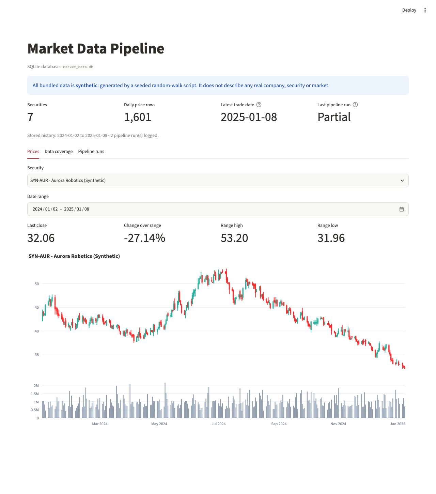
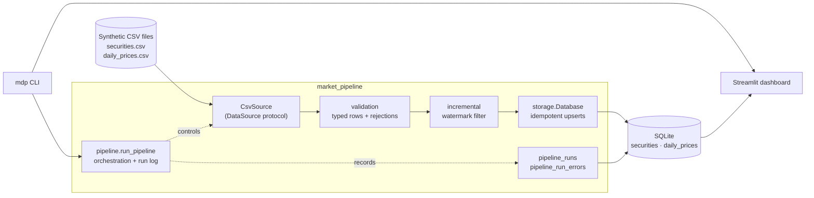

# Market Data Pipeline

An offline-first ETL pipeline for daily stock prices. It reads CSV data, validates every row,
loads it incrementally into SQLite with idempotent upserts, records every run, and ships a
Streamlit dashboard for exploring the result.

It runs entirely on a bundled **synthetic** dataset, so it needs no API keys, no network
access and no database server.



## Features

- **CSV ingestion behind a source interface.** `DataSource` is a small protocol, and
  `CsvSource` is the implementation that ships. The pipeline never depends on where the data
  comes from.
- **Row-level validation.** Checks required fields, ISO dates, positive finite prices,
  whole-number non-negative volume, OHLC consistency (`high >= open/close/low`,
  `low <= open/close`) and duplicate `(symbol, date)` rows. Rejected rows are kept with a
  reason and a `file:line` reference instead of being dropped silently.
- **Idempotent loading.** `UNIQUE (symbol, trade_date)` plus `INSERT ... ON CONFLICT DO UPDATE`.
  Each incoming row is classified as *inserted*, *updated* or *unchanged*, so re-running a
  load never creates duplicates.
- **Incremental updates.** By default only rows newer than the latest stored date for each
  symbol are loaded (watermark). `--full-refresh` re-checks every row and applies corrections
  to history.
- **Run logging and failure isolation.** Every run is stored in `pipeline_runs` with its
  timestamps, status (`success`, `partial_success`, `failed`) and row counters. Individual
  problems go to `pipeline_run_errors`. One failing symbol doesn't stop the others, and runs
  left `running` by a crash are marked failed on the next start.
- **CLI.** `mdp init-db`, `mdp run`, `mdp status`, `mdp dashboard`, with exit codes suitable
  for schedulers.
- **Streamlit dashboard.** Overview metrics, a security picker, a candlestick and volume chart,
  data coverage per security, and pipeline run history with recorded errors.

## Architecture



**Data flow for one run:** start a run row → read and validate securities → upsert them →
for each symbol: read prices → validate → drop rows at or before the watermark → upsert →
count the results → store errors → set the final status.

### Schema

| Table | Purpose | Keys and constraints |
|---|---|---|
| `securities` | One row per instrument | `symbol` primary key |
| `daily_prices` | One OHLCV bar per symbol per day | `UNIQUE (symbol, trade_date)`, foreign key to `securities`, `CHECK` on positive prices, non-negative volume and `high >= low` |
| `pipeline_runs` | One row per pipeline run | status and mode `CHECK` constraints, counters, timestamps, error message |
| `pipeline_run_errors` | Individual problems in a run | foreign key to `pipeline_runs` |

The full DDL is in [`src/market_pipeline/schema.sql`](src/market_pipeline/schema.sql).

### Project layout

```
src/market_pipeline/
  sources/          DataSource protocol and the CSV implementation
  validation.py     raw text records -> typed PriceBar / Security, with rejections
  incremental.py    watermark split
  storage.py        all SQL: schema, upserts, run logging, read queries
  pipeline.py       orchestration, status rules, error capture
  reporting.py      coverage calculations shared by CLI and dashboard
  cli.py            the `mdp` command
  dashboard/app.py  Streamlit app
  sample_data/      synthetic CSVs (base year + update batch)
scripts/generate_sample_data.py   deterministic generator for the sample data
tests/                            pytest suite
```

## Tech stack

- Python 3.10+. The pipeline uses only the standard library (`csv`, `sqlite3`, `dataclasses`).
- SQLite for storage
- Streamlit and Plotly for the dashboard (optional extra)
- pytest, Ruff and mypy (`strict`); GitHub Actions for CI

## Quick start

```bash
git clone https://github.com/Hans1guo/market-data-pipeline.git
cd market-data-pipeline
python -m venv .venv
source .venv/bin/activate          # Windows: .venv\Scripts\activate
pip install -e ".[dashboard,dev]"

mdp run                            # load the bundled synthetic base dataset
mdp dashboard                      # open http://localhost:8501
```

The database is created at `data/market_data.db` (ignored by Git). Use `--db PATH` or the
`MDP_DB_PATH` environment variable to put it somewhere else.

## CLI usage

```bash
mdp init-db                          # create the schema (safe to re-run)
mdp run                              # incremental load of the synthetic base dataset
mdp run                              # again: 0 inserted, every row skipped
mdp run --sample update              # new days, a new security, bad rows -> partial_success
mdp run --sample update --full-refresh   # re-checks history and applies the correction
mdp run --data-dir path/to/csvs      # your own securities.csv + daily_prices.csv
mdp run --symbols SYN-AUR,SYN-BLU    # only some symbols
mdp status                           # recent runs and coverage
mdp status --run-id 3                # every problem recorded for run 3
mdp -v run                           # per-symbol progress logging
```

Exit codes: `0` success, `1` failed, `3` partial success (`2` is argparse's usage error).

Example output of `mdp run --sample update` after a first `mdp run`:

```
Run #2: partial_success (mode=incremental, source=csv)
  securities  loaded=7 rejected=0
  symbols     planned=7 succeeded=7 failed=0
  price rows  read=40 inserted=35 updated=0 unchanged=0 skipped=1 rejected=4
  problems (4):
    [validate_price] SYN-BLU: daily_prices.csv:38: high 10.0 is below open, close or low
    [validate_price] SYN-COB: daily_prices.csv:39: 'trade_date' is not a real date: '2025-13-01'
    [validate_price] SYN-DLT: daily_prices.csv:40: 'volume' must not be negative, got '-500'
    [validate_price] SYN-EVR: daily_prices.csv:41: duplicate row for SYN-EVR on 2025-01-06
```

### CSV format

`securities.csv`: `symbol,name,exchange[,sector]`
`daily_prices.csv`: `symbol,trade_date,open,high,low,close,volume` (dates as `YYYY-MM-DD`)

## Dashboard

`mdp dashboard` starts Streamlit on port 8501 (`--port` to change it, `--headless` to skip
opening a browser). It sends no usage statistics. If the database is empty, the dashboard
offers a button to load the synthetic sample. The tabs:

- **Prices:** pick a security and a date range; candlestick chart with volume, plus last close,
  change, high and low for the range
- **Data coverage:** rows, first and last date, and coverage against expected weekdays for
  each security
- **Pipeline runs:** run history with all counters, and the recorded problems for any run

## Testing

```bash
pytest            # unit, integration, end-to-end and dashboard smoke tests
ruff check .      # lint
ruff format --check .
mypy              # strict type checking of src/
```

What the suite covers:

- **Validation:** every rejection rule, duplicate handling, source references
- **CSV source:** bundled data, missing files and columns, BOM and whitespace, bad encoding
- **Storage:** schema idempotency, insert/update/unchanged classification, `UNIQUE`,
  foreign key and `CHECK` enforcement, transaction rollback, run logging, stale-run recovery
- **Incremental logic:** watermark filtering
- **Pipeline:** end-to-end loads of the bundled datasets, no duplicates on re-run,
  partial and total failure, unreadable sources, symbol subsets
- **CLI:** `init-db`, `run` and `status`, their options and exit codes (`dashboard` is
  checked manually; it only launches Streamlit)
- **Dashboard:** rendered headlessly with Streamlit's `AppTest`, both empty and populated

CI runs lint, type checks, tests and a CLI smoke test on Python 3.10–3.13.

## Design decisions

- **Standard library for the core.** `csv` and `sqlite3` keep the pipeline dependency-free
  and easy to read. pandas would add weight without simplifying row-level validation.
- **All SQL in one class.** `Database` is the only module that talks to SQLite. Supporting
  PostgreSQL would mean a second implementation of that class (the upsert syntax is nearly
  identical); the pipeline wouldn't change. No ORM, to keep the SQL visible.
- **Classify, then upsert.** Existing rows are read inside the same `BEGIN IMMEDIATE`
  transaction before writing, so the run log can report inserted, updated and unchanged rows
  accurately instead of a single "affected rows" number.
- **Watermark incremental loads, with an explicit full refresh.** Cheap daily runs by default.
  Corrections to history are a deliberate `--full-refresh`, and the skipped count makes the
  difference visible.
- **Partial success is a real status.** Bad rows and failing symbols are recorded and surfaced
  (status, exit code 3, dashboard) without throwing away the good data.
- **Synthetic, deterministic sample data.** Generated by a seeded script, so anyone can rebuild
  it and the tests can assert exact counts.

## Limitations

- Only a CSV source is implemented. The `DataSource` protocol is ready for a documented
  public API, but none is included.
- Prices are stored as SQLite `REAL` (floating point), which is fine for a demo; a production
  system handling money would use fixed-point decimals.
- The watermark approach does not backfill gaps *before* the latest stored date in incremental
  mode; use `--full-refresh` for that.
- Coverage counts Monday–Friday dates and does not model exchange holidays.
- No built-in scheduler; run `mdp run` from cron, a CI schedule or another orchestrator.
- SQLite with a single writer; not designed for concurrent pipeline runs.
- Tested locally on macOS with Python 3.12 and 3.13. The CI workflow covers Python 3.10–3.13
  on Linux.

## Data

All bundled data is synthetic (see
[`src/market_pipeline/sample_data/README.md`](src/market_pipeline/sample_data/README.md)).
Symbols (`SYN-*`), company names and the `DEMO` exchange are made up. Nothing in this
repository comes from a real market data provider.

## Background

This is an independent portfolio project, written from scratch to demonstrate
data-engineering practices: incremental loading, idempotency, validation and run
observability. It contains no code, schemas, data or documents from any employer.

## License

[MIT](LICENSE)
